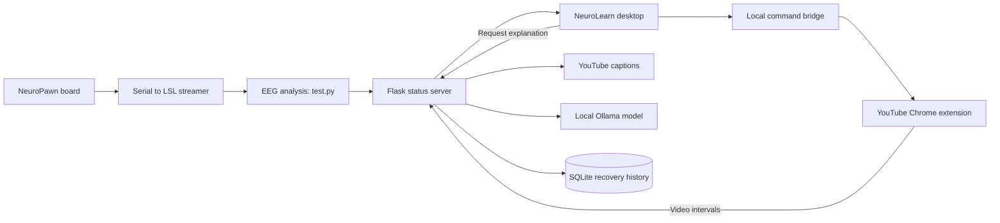

# NeuroLearn

An EEG-assisted lecture companion that helps you revisit parts of a YouTube lecture you may have missed. NeuroLearn tracks attention signals, records distraction intervals using video timestamps, and lets you replay those intervals or request a caption-based explanation from a local Ollama model.

## Features

- **Live EEG monitoring:** alpha and beta band plots, their ratio, calibration, and posture monitoring when IMU channels are available.
- **Shared attention status:** the EEG app publishes Focused, Unfocused Pending, and Unfocused Alert states through a local Flask server.
- **YouTube replay:** a Chrome extension remembers distraction timestamps, replays at a reduced speed, and restores the original speed when playback catches up.
- **AI Lecture Recovery:** fetch overlapping captions and generate a summary, key concepts, and a review question with Ollama.
- **Saved recovery history:** revisit captured intervals and explanations, or use **Clear Recovery History** to start fresh.
- **Headset-free demo:** simulate focus changes before connecting EEG hardware.

## How it works



The desktop starts the command bridge automatically. EEG processing and AI generation run separately, so requesting an explanation does not block the desktop UI.

## Requirements

- Python 3.10 or newer; the instructions below use Windows PowerShell.
- Google Chrome for the YouTube extension.
- [Ollama](https://ollama.com/download) with a locally installed model for AI explanations.
- Internet access for dependency installation and YouTube captions.
- Optional: a supported NeuroPawn Knight board for live EEG input. The included streamer supports 8 EXG channels and an additional 9 IMU channels on an IMU board.
- Optional: Node.js to run the extension's automated checks.

## Setup

Clone the repository, or open a terminal in your existing checkout:

```powershell
git clone https://github.com/moreharsh/neurotech-hackathon.git
cd neurotech-hackathon
```

Create a virtual environment and install dependencies:

```powershell
py -m venv .venv
.\.venv\Scripts\python.exe -m pip install -r requirements.txt
```

If you already have `.venv`, reuse it. The commands below call its Python directly, so activation is not required.

Install and start Ollama, then download the default model:

```powershell
ollama pull llama3.2
ollama list
```

If the Ollama service is not running, run `ollama serve` in a separate terminal. Keep it running while generating explanations.

### Load the Chrome extension

1. Open `chrome://extensions` in Chrome.
2. Enable **Developer mode**.
3. Click **Load unpacked** and select the repository's `chrome_extension` folder.
4. Open a YouTube lecture with accessible English captions.

After changing extension code, click **Reload** on its extension card and refresh the YouTube page.

## Quick start: no headset required

Run these commands in **two separate terminals**, both opened in the repository folder. Leave both running.

**Terminal 1 — status and recovery server:**

```powershell
.\.venv\Scripts\python.exe status_server.py
```

**Terminal 2 — desktop app:**

```powershell
.\.venv\Scripts\python.exe desktop_app.py
```

Then:

1. Play a captioned YouTube lecture. Keep it selected in your most recently focused Chrome window.
2. In NeuroLearn, click **Start Session**.
3. In another terminal, run `.\.venv\Scripts\python.exe simulate_status.py` to publish a short sequence of focus changes.
4. Wait for focus to return and the captured interval to appear.
5. Select the captured interval in **AI Lecture Recovery** and click **Explain What I Missed**.
6. For distractions lasting at least 10 seconds, a popup appears on YouTube. Click **Rewind Lecture** to replay or **Continue** to dismiss it. The short simulator sequence does not trigger this popup.

**Leave `test.py` closed during this demo** so it does not overwrite the simulator's focus states.

## Run with real EEG

Keep the server, desktop, and extension running as described above.

**Start the board streamer in another terminal:**

```powershell
.\.venv\Scripts\python.exe NeuropawnReciever.py
```

Select the board's serial port, connect, configure the channels as appropriate for your board, and click **Start Stream**. If another application already publishes the compatible `NeuroPawnKnight` LSL stream, use that instead of starting a second streamer.

**Start EEG analysis in another terminal:**

```powershell
.\.venv\Scripts\python.exe test.py
```

1. Click **Refresh** if necessary and select `NeuroPawnKnight`.
2. Click **Connect Stream**.
3. Click **Calibrate (10s)** and follow the on-screen instructions.
4. Play the lecture and click **Start Session** in the desktop app.

The desktop now tracks real focus transitions. Both Pending and Alert states begin distraction tracking during an active session; returning to Focused closes the interval. The EEG window displays alpha/beta plots and posture information; there is no Focus % chart.

Despite its filename, **`test.py` is the EEG application**, not an automated test suite.

## Recovery history and new videos

Completed captures are saved locally and remain available after restarting the apps. The desktop selector shows the latest 50 intervals.

When starting a new lecture, click **Clear Recovery History** to delete saved intervals, captions, and explanations **for all videos**. The selector and explanation display reset. This does not delete debug logs or EEG recordings.

Switching to another YouTube video cancels an unfinished capture but preserves saved history. Clearing history during generation does not stop the Ollama request; its deleted record will not reappear when that request finishes.

## Configuration

Set environment variables in the server terminal **before** starting `status_server.py`.

| Variable | Default | Purpose |
| --- | --- | --- |
| `OLLAMA_MODEL` | `llama3.2` | Installed model used for explanations |
| `OLLAMA_URL` | `http://127.0.0.1:11434` | Ollama server address |
| `TRANSCRIPT_LANGUAGES` | `en` | Comma-separated caption language preference |
| `NEUROLEARN_DB` | `data/recovery.sqlite3` | Recovery database location |

For example, to try another model already installed on your machine:

```powershell
$env:OLLAMA_MODEL = "qwen2.5:3b"
.\.venv\Scripts\python.exe status_server.py
```

Local services use port **5001** for Flask, **8765** for the desktop command bridge, and **11434** for Ollama by default. Run the applications on the same machine and keep Flask bound to loopback.

## Troubleshooting

| Problem | What to check |
| --- | --- |
| Desktop says server offline | Start `status_server.py`; open `http://127.0.0.1:5001/health` and check for `ok: true`. |
| Waiting for EEG | Expected during the button-based demo. With hardware, check the streamer, connect `test.py`, and resume processing if paused. |
| Focus labels disagree | Inspect `http://127.0.0.1:5001/api/status` and compare the sender, server, and desktop logs. Data becomes stale after roughly 3 seconds without updates. |
| No recovery interval appears | Load/reload the extension, refresh YouTube, play the video, start a desktop session, and complete an unfocused-to-focused transition. |
| Captions cannot be fetched | Try a video with accessible captions in the configured language. YouTube may block requests or restrict a video. |
| Ollama unavailable or model missing | Run `ollama list`, verify the configured model exists, and ensure Ollama is running. |
| Another explanation is generating | Only one generation job runs at a time. Wait for it to complete or fail, then retry. |
| Port already in use | Close the duplicate server or desktop process before restarting. |
| Button missing after an update | Restart the desktop and server so they load the updated Python code. |

## Data and limitations

- `data/recovery.sqlite3` stores video IDs, intervals, selected captions, model names, explanations, and generation status.
- `logs/` contains timestamped application logs. `log/` contains EEG CSV recordings written by the EEG app.
- The recovery database and new files under `logs/` are ignored by Git. Previously tracked files remain tracked; EEG recordings under `log/` are not covered by that ignore rule.
- Captions are downloaded from YouTube. Only the selected caption text and tutor instructions are sent to the configured Ollama server; raw EEG is not sent to the model.
- Explanations cover overlapping caption segments, including sentences that cross interval boundaries. They do not independently analyze diagrams, video frames, or audio, and may be incomplete or incorrect.
- Capture uses video time. Pauses add no video duration; seeking during a capture can make the interval misleading. Intervals longer than 30 minutes are rejected.
- Failed interval uploads retry while the YouTube tab remains open. Closing it before a successful save loses the pending capture.
- The Chrome extension controls playback. `youtube_control.py` is a separate legacy keyboard demo; do not run it alongside this workflow.

## Project files

| File or directory | Role |
| --- | --- |
| `NeuropawnReciever.py` | Serial board acquisition and LSL streaming |
| `test.py` | EEG processing, calibration, plots, and attention publishing |
| `status_client.py` | Background sender for EEG attention states |
| `status_server.py` | Flask status service and recovery API registration |
| `desktop_app.py` | Session controls and desktop attention display |
| `bridge.py` | Local command delivery to the extension |
| `chrome_extension/` | Video interval capture and playback control |
| `lecture_ai.py` | Caption retrieval and Ollama requests |
| `recovery_api.py` | Persistent recovery records and background generation |
| `recovery_panel.py` | Desktop recovery selector, explanation display, and clear button |
| `sync_logging.py` | Shared timestamped logging |
| `simulate_status.py` | Headset-free status publisher |

## Tests

```powershell
.\.venv\Scripts\python.exe -m unittest test_recovery test_connection
node test_extension.cjs
```

The Python checks cover recovery validation, persistence, retries, generation concurrency, clearing history, caption selection, and simulated LSL input. The JavaScript checks use a simulated video player. They do not replace a manual Chrome, YouTube, and hardware session.

## Local API

| Method | Endpoint | Behavior |
| --- | --- | --- |
| GET | `/health` | Server health |
| GET / POST | `/api/status` | Read or publish attention status |
| GET | `/api/distractions` | Latest 50 saved intervals and results |
| POST | `/api/distractions` | Save an interval; repeated IDs do not create duplicates |
| DELETE | `/api/distractions` | Delete all recovery records |
| POST | `/api/distractions/<id>/explain` | Start generation or return an existing explanation |

An interval request contains `video_id`, `start`, and `end` in video seconds, with an optional unique `id`. Generation returns 202 when started, 200 for a cached result, or 409 when busy. Poll the list for `ready`, `generating`, `complete`, or `error`. Interrupted jobs become retryable after restarting the server.

Integration references: [YouTube Transcript API](https://github.com/jdepoix/youtube-transcript-api) and [Ollama generation API](https://docs.ollama.com/api/generate).
